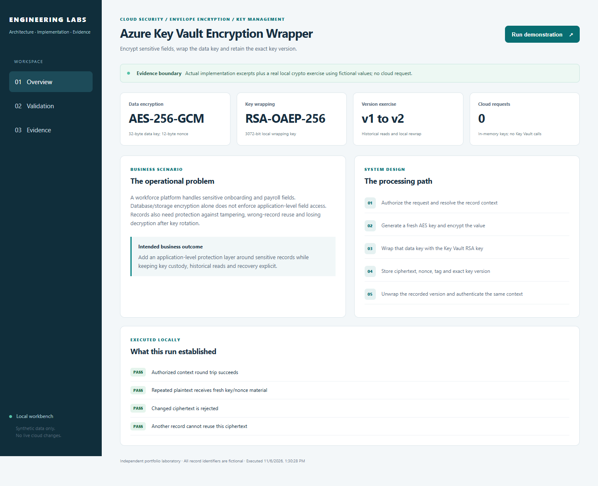
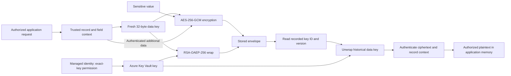
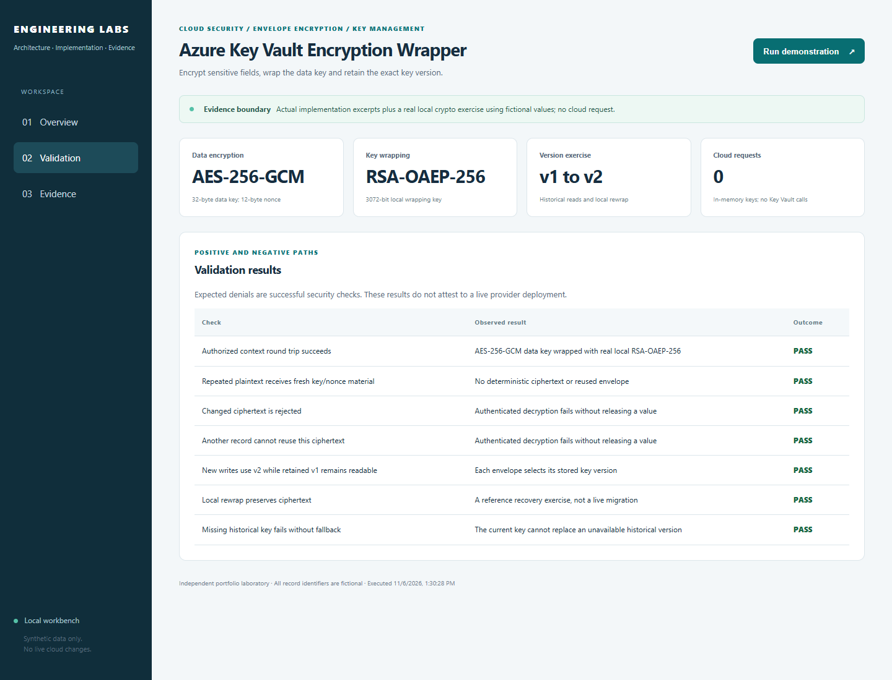

# Azure Key Vault Encryption Wrapper

**Protect sensitive fields even if someone obtains a copy of the stored records.**

[The problem](#the-business-problem) · [The solution](#the-solution) · [What was built](#what-was-built) · [Proof it works](#proof-it-works) · [Commands](docs/COMMANDS.md) · [Step by step](#step-by-step)



## The Business Problem

The application handles sensitive onboarding and payroll details. Encryption provided by the database or storage service is useful, but the application also needs control over who can read individual fields. Older records must remain readable after encryption keys change.

## The Solution

Encrypt each sensitive value with its own temporary data key. Use Azure Key Vault to protect that key, and save the exact key version needed to read the record later. Check that the encrypted value still belongs to the correct record before returning it.

**Business outcome:** Add protection around sensitive fields while keeping access, key changes and recovery clearly defined.

### Actual implementation

This case study comes from the workforce platform I built and operated. It includes actual sensitive-field and bank-details encryption source/tests, the Key Vault adapter boundary and related key/RBAC Terraform. The deployed pattern also supports separate payroll/form encryption domains. No real records, credentials, tenant IDs or production state are included.

The local demonstration uses real cryptography with temporary in-memory RSA keys. It is not a cloud permission test or a production practice recovery. [Evidence scope](docs/VALIDATION.md) and [source mapping](docs/SOURCE-MAP.md) separate the layers.

## Step by Step

A short walkthrough of the process, with technical instructions and evidence limits in the sections below.

1. **Choose the sensitive value** — The application identifies the value and the record it belongs to. Only an authorized operation should request encryption or decryption.

2. **Encrypt and protect the key** — A fresh data key encrypts the value. Azure Key Vault protects that data key, and the stored record retains the required key version.

3. **Recover the value when permitted** — The application uses the recorded key version to recover the data key. It checks that the encrypted content still belongs to the expected record before returning the value.

4. **Test changes and plan recovery** — The local examples check altered content, wrong record details and key-version handling. Keeping required older keys is a separate operational responsibility from encrypting new values.

## Architecture



## What Was Built

| Component | Role in plain words | Implementation |
| --- | --- | --- |
| Actual AES-GCM field wrapper | Fresh DEK/nonce, authenticated record binding and validated decryption | [Source](reference/fieldEncryption.ts) |
| Actual bank-details wrapper | Protect a JSON payload with a separate authenticated domain | [Source](reference/bankDetailsEncryption.ts) |
| Exact key/version validation | Reject a foreign key identifier or incorrectly structured historical version | [Rules](reference/keyIdentifiers.ts) |
| Key Vault wrapping adapter | Use managed identity and recorded key version for RSA wrap/unwrap | [Adapter](reference/keyVaultAdapter.ts) |
| Real local crypto exercise | Demonstrate tampering, context binding, rotation and reference rewrap without cloud calls | [Reference](lab/envelope.py) |
| Vault/key and scoped RBAC | A private vault, an optional RSA-3072 key for protecting data keys, and application access limited to that key | [Terraform](infra/main.tf) |

## Proof It Works

### 1. The actual field-encryption rules pass their tests

```bash
npm run test:source
```

**What to look for:** The extracted tests preserve leading zeroes, use fresh nonce/key material, reject wrong-context/tampered values and check invalid DEK lengths. Additional public tests cover exact key/version construction. Injected wrapper fixtures isolate AES behavior; those fixtures are not claimed as RSA or Key Vault acceptance.

### 2. Real AES/RSA round trips succeed and tampering fails

```bash
python -B -m unittest discover -s tests -v
python -B -m lab demo
```

**What to look for:** A fictional value round-trips with a real local RSA-wrapped AES key. Changed encrypted value, wrong record/field, incorrectly structured nonce/tag and unavailable key versions are rejected. No plaintext is released after an authentication failure.

### 3. Rotation does not replace the historical key reference

The demonstration writes with v1, rotates new writes to v2, reads the retained v1 record and exercises a local rewrap while preserving encrypted value. It then removes only its temporary local v1 key to show that the latest key is not a fallback.

```bash
python -B -m unittest discover -s tests -p test_envelope.py -k rotation -v
python -B -m unittest discover -s tests -p test_envelope.py -k missing_version -v
```

This is a reference exercise, not a production rewrap/migration command. Key Vault expiry, disable, delete and purge have different effects; [rotation/recovery](docs/RECOVERY.md) explains them.

### 4. Visible local evidence



See [dated validation](docs/VALIDATION.md) for counts, tool versions and boundaries. No cloud key was created, rotated, backed up, disabled or deleted to produce these images.

## Security Practices

- The full payload stays in the application; Key Vault protects the small data key. The stored envelope contains no plaintext DEK.
- Authenticated additional data binds the record/field and domain. It is context, not a password or a replacement for access control.
- The runtime gets wrap/unwrap permission at one key, not subscription-wide key administration.
- Preserve historical versions and metadata. Do not silently use the latest key when an older version is missing.
- The source clears owned key/plaintext buffers in `finally`; managed-runtime copies/strings mean guaranteed memory erasure is not claimed.
- Application authorization, TLS, database/storage encryption, auditing and least privilege remain required.

## Run It Locally

Use Python 3.12 and Node 22.18+ (source validation used Node 22.23.2).

```bash
python -m venv .venv
source .venv/bin/activate
python -m pip install -r requirements.txt
npm run test:source
python -B -m unittest discover -s tests -v
python -B -m lab serve --port 8011
```

Windows: use `.venv\Scripts\python.exe` and `npm.cmd` where needed. Open [the loopback workbench](http://127.0.0.1:8011). Stop with Ctrl+C. No Azure credential or SDK install is required for the default source tests. The optional Azure adapter has declared SDK dependencies and requires separate configuration/integration.

## Terraform Infrastructure

```bash
terraform -chdir=infra init -backend=false -input=false
terraform -chdir=infra fmt -check -recursive
terraform -chdir=infra validate
terraform -chdir=infra test
```

The root defines a private Standard Key Vault, purge/soft-delete protection, a separately enabled RSA-3072 key and an optional exact-key runtime grant. Key creation remains Off until the operator has proved the private caller path and deployment permissions. Mock tests do not establish that reachability. Read [the infrastructure guide](infra/README.md).

## Scaling and Tradeoffs

Envelope encryption keeps bulk payload work local and makes key control explicit, but adds key-service latency, permissions and recovery dependencies. Bound concurrency, monitor wrap/unwrap failures and retain version references. Avoid plaintext/DEK caching without a separately reviewed design. Read [strengths, weaknesses and tradeoffs](docs/SCALING.md).

## Skills Demonstrated

- Application-level envelope encryption and authenticated data
- Azure Key Vault, managed identity and scoped cryptographic permissions
- AES-256-GCM and RSA-OAEP-256 using established libraries
- Exact-version rotation/recovery and failure handling
- Terraform, source tests and operational documentation

## Project Guides

| Guide | Purpose |
| --- | --- |
| [Architecture](docs/ARCHITECTURE.md) | Trust boundaries and data/key flow |
| [Walkthrough](docs/WALKTHROUGH.md) | Follow encryption and decryption step by step |
| [Stored envelope](docs/STORED-ENVELOPE.md) | Understand each persisted field |
| [Commands](docs/COMMANDS.md) | Copy commands and check expected outcomes |
| [Recovery](docs/RECOVERY.md) | Rotation, historical keys, backup and restore boundaries |
| [Operations](docs/OPERATIONS.md) | Diagnose service, permission and authentication failures |
| [Validation](docs/VALIDATION.md) | See what the local tests prove and what was not tested in Azure |
| [Source map](docs/SOURCE-MAP.md) | Actual source versus public adapters and namespace changes |
| [Screenshot plan](docs/SCREENSHOT-PLAN.md) | Capture actual nonproduction portal/terminal evidence later |
| [References](docs/REFERENCES.md) | Technical sources and presentation credits |

## Cost and Cleanup

The default exercise creates no cloud resource and writes no private key or real sensitive data to disk. Key Vault operations, diagnostics and provisioned resources can be billed in a commissioned environment. Purge protection and `prevent_destroy` are intentional recovery controls, not obstacles to bypass for quick cleanup. CI is manual-only and no workflow is dispatched by this documentation.
