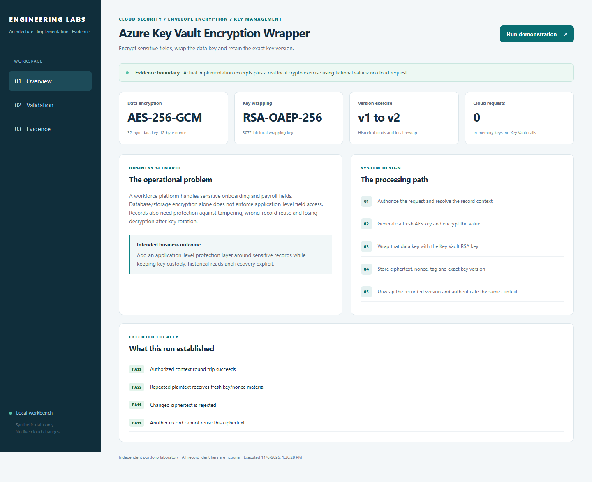
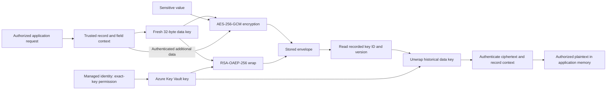
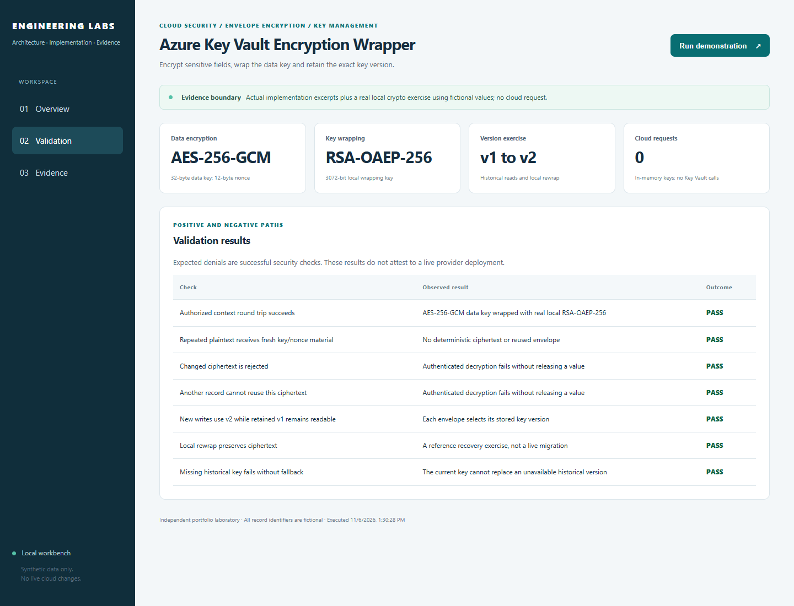

# Azure Key Vault Encryption Wrapper

**Protect sensitive fields even if someone obtains a copy of the stored records.**

[The problem](#the-business-problem) · [The solution](#the-solution) · [What was built](#what-was-built) · [Proof it works](#proof-it-works) · [Commands](docs/COMMANDS.md) · [Step by step](#step-by-step)



## The Business Problem

Onboarding and payroll administration require sensitive personal and payment details to be stored and retrieved by authorized staff. Those values can outlive a single deployment and may also appear in database backups. Protecting access to the database is necessary, but the organization also needs protection around the stored field values themselves.

Encryption introduces a recovery responsibility: an older record must remain readable with the key version that protected it. Moving encrypted bytes to the wrong employee or field must also fail rather than produce a valid-looking result in the wrong context. Lost key material can make retained records unusable even when the database is intact.

The business need was additional protection for sensitive fields, tied to the right record and supported by clear key custody, versioning and recovery requirements.

## The Solution

Encrypt each sensitive value with its own temporary data key. Use Azure Key Vault to protect that key, and save the exact key version needed to read the record later. Check that the encrypted value still belongs to the correct record before returning it.

**Business outcome:** Add protection around sensitive fields while keeping access, key changes and recovery clearly defined.

### Actual implementation

This case study comes from the workforce platform I built and operated. It includes actual sensitive-field and bank-details encryption source/tests, the Key Vault adapter boundary and related key/RBAC Terraform. The deployed pattern also supports separate payroll/form encryption domains. No real records, credentials, tenant IDs or production state are included.

The local demonstration uses real cryptography with temporary in-memory RSA keys. It is not a cloud permission test or a production practice recovery. [Evidence scope](docs/VALIDATION.md) and [source mapping](docs/SOURCE-MAP.md) separate the layers.

## Tools Used and What They Do

| Tool or service | What it does | Where it fits |
| --- | --- | --- |
| Node.js node:crypto | Encrypt/decrypt values and generate fresh random data keys. | Actual application cryptography implementation. |
| AES-256-GCM and RSA-OAEP-256 | Protect the value and separately wrap its small data key. | Algorithms, not separate services or scanner products. |
| Azure Key Vault | Hold the versioned wrapping key. | Actual hosted key boundary; the database does not store the unwrapped key. |
| Azure Identity and Key Vault Keys SDKs | Obtain workload credentials and call the key cryptography operations. | Selected hosted adapter; real service calls are not part of default tests. |
| Python cryptography | Run the public encryption illustration with local keys. | Reference library, separate from the actual Node.js implementation. |
| Terraform and the Node test runner | Describe the key policy and test extracted encryption rules. | Local/source validation; no live rotation or key migration is performed. |

A new key version does not automatically rewrite old encrypted values. The stored version and original record context remain part of recovery.

## Step by Step

Your own field-encryption script that wraps a fresh AES data key with a versioned Azure Key Vault RSA key before a value could be stored in SQL.

[Open the standalone build guide](docs/BUILD-YOUR-OWN.md) or follow the same complete instructions below.

Start with a new folder, your own files and your own accounts. The numbered steps below describe the build; no portfolio repository checkout is required. The existing implementation/evidence elsewhere in this repository is a separate reference, not a claim that your new build has already passed.

### Prerequisites

Python, Azure CLI, a new Key Vault/RSA wrapping key and a runtime identity permitted to read/wrap/unwrap that key. The vault setup administrator and runtime key user are separate responsibilities.

Use Bash on Linux/macOS/WSL for Bash blocks and PowerShell for PowerShell blocks. Select the tool versions supported by the official sources below, record the versions you actually install and retain generated dependency locks. Cloud resources, scanner downloads, logs and external AI calls can create costs; review the stated scope before enabling them.

### Create your project folder

Choose a new folder name. These first commands create a blank project; an optional `git init` gives it its own history. Create parent directories in your editor when a later step introduces a nested file.

```bash
mkdir my-azure-envelope-encryption
cd my-azure-envelope-encryption
git init
```

Create `.gitignore` before saving credentials or build outputs:

```gitignore
.venv/
node_modules/
.env
.env.*
local.settings.json
credentials.json
token.json
*.pem
*.key
*.tfstate*
*.tfplan
.terraform/
private*/
captures/
backups/
batch.json
reports/
out/
app-config.local.yaml
```

The source/file snippets are a starting implementation you type or paste into the named files. Replace `YOUR_*`, names, regions and addresses only with values from your own lab; do not place real client/employee records in a test project. Keep your terminal in this project root unless a step explicitly changes directory.

Before a first commit, set your own repository-local author with `git config user.name "YOUR_NAME"` and `git config user.email "YOUR_PUBLIC_COMMIT_EMAIL"`. Review `git status --short` and the staged diff before publishing; ignored local files are not a substitute for reviewing what you upload.

### Step 1 — Create your vault and wrapping key

**Where:** Azure Portal → Key Vault → Keys.

Create a vault with RBAC and appropriate network/recovery settings, then create an RSA wrapping key through your setup administrator. Record the key's full versioned ID privately and assign the intended runtime identity only the required crypto operations.

**Check before continuing:** A specific key version exists and the intended runtime caller can reach/use it.

### Step 2 — Install your crypto dependencies

**Where:** Your new project folder.

Create a virtual environment and install the libraries below. Record their resolved versions and keep credentials, encrypted business samples and Terraform state out of Git.

```bash
python3 -m venv .venv
.venv/bin/python -m pip install cryptography azure-identity azure-keyvault-keys
.venv/bin/python -m pip freeze > requirements.lock.txt
```

**Check before continuing:** The selected Python environment imports the local and Azure crypto clients.

### Step 3 — Create the field wrapper

**Where:** Your editor.

Create key_version.py and encrypt_field.py below. The helper rejects a versionless/unapproved key URL and the wrapper records the actual wrapping-response key version only if it matches the selected one; record-ID context is authenticated separately by AES-GCM.

Create **`key_version.py`** with the following contents:

```python
import re
from urllib.parse import urlsplit

def versioned_key_id(value):
    if not isinstance(value, str) or value.strip() != value:
        raise ValueError('Use the exact versioned Key Identifier from your public-Azure vault')
    uri = urlsplit(value)
    parts = uri.path.split('/')
    if (uri.scheme != 'https' or not (uri.hostname or '').endswith('.vault.azure.net')
        or uri.username is not None or uri.password is not None or uri.port is not None
        or uri.query or uri.fragment or len(parts) != 4 or parts[1] != 'keys'
        or not re.fullmatch(r'[A-Za-z0-9-]+', parts[2])
        or not re.fullmatch(r'[A-Za-z0-9-]+', parts[3]) or parts[3].lower() == 'latest'):
        raise ValueError('Use https://YOUR_VAULT.vault.azure.net/keys/NAME/VERSION, not a versionless or portal URL')
    return f'https://{uri.hostname}/keys/{parts[2]}/{parts[3]}'

def matching_wrapping_version(requested, returned):
    expected = versioned_key_id(requested)
    actual = versioned_key_id(returned)
    if expected != actual:
        raise ValueError('The wrapping response identifies a different key/version; do not store this envelope')
    return actual
```

Create **`encrypt_field.py`** with the following contents:

```python
import os, json, base64
from cryptography.hazmat.primitives.ciphers.aead import AESGCM
from azure.identity import AzureCliCredential
from azure.keyvault.keys.crypto import CryptographyClient, KeyWrapAlgorithm
from key_version import versioned_key_id, matching_wrapping_version

def b64(data): return base64.b64encode(data).decode('ascii')
key_id = versioned_key_id(os.environ['WRAPPING_KEY_VERSION_ID'])
credential = AzureCliCredential()
crypto = CryptographyClient(key_id, credential)
dek = AESGCM.generate_key(bit_length=256)
nonce = os.urandom(12)
aad = b'employee:LAB-001:private-field:v1'
ciphertext = AESGCM(dek).encrypt(nonce, b'fictional-private-value', aad)
wrap_result = crypto.wrap_key(KeyWrapAlgorithm.rsa_oaep_256, dek)
recorded_version = matching_wrapping_version(key_id, wrap_result.key_id)
wrapped = wrap_result.encrypted_key
envelope = {'schema': 1, 'key_id': recorded_version, 'nonce': b64(nonce),
            'ciphertext': b64(ciphertext), 'wrapped_key': b64(wrapped)}
recovered = crypto.unwrap_key(KeyWrapAlgorithm.rsa_oaep_256, wrapped).key
assert AESGCM(recovered).decrypt(nonce, ciphertext, aad) == b'fictional-private-value'
print(json.dumps({'round_trip': True, 'envelope_fields': list(envelope)}))
```

**Check before continuing:** The file separates the encrypted value, nonce, wrapped data key and wrapping-key version.

### Step 4 — Run with your intended identity

**Where:** Your private terminal configuration.

Sign in as the intended key user and enter the exact versioned Key Identifier from your public-Azure vault. The script rejects a versionless URL before a key operation and refuses a different returned key/version; these are real Key Vault calls only when you run this in your own lab.

```bash
az login
read -r -p 'Versioned Key Identifier from your lab vault: ' WRAPPING_KEY_VERSION_ID
export WRAPPING_KEY_VERSION_ID
.venv/bin/python encrypt_field.py
```

**Check before continuing:** The script reports a successful fictional round trip without printing plaintext or a data key.

### Step 5 — Prove failure and storage boundaries

**Where:** Your own tests and SQL design.

Add tests for a changed ciphertext/tag, a different record-ID context and missing unwrap permission; each must fail without returning a value. Store the envelope in SQL only after encryption, and enforce database record authorization separately from the ability to unwrap a key.

**Check before continuing:** Integrity, identity context, key access and SQL ownership are distinct tested controls.

### Step 6 — Plan rotation and recovery before cleanup

**Where:** Your key/version inventory.

Keep old key versions available for data that still references them, test backup/recovery access and choose explicit rewrap/re-encrypt procedures if rotating. Never delete an old key merely because a newer one exists; remove only a dedicated lab after its encrypted data is no longer required.

**Check before continuing:** The reader can explain encryption before SQL storage and why key deletion can destroy recovery.

### Verification and your own screenshots

| Evidence | What to record | Your result |
| --- | --- | --- |
| New build | Your own files/resource settings and tool versions | Not yet recorded |
| Working path | The actual successful request, configuration or recovery result | Not yet recorded |
| Failure boundary | A meaningful denied, malformed, stale or failed case | Not yet recorded |
| Recovery / cleanup | What you restored or removed and what remains billed | Not yet recorded |

Capture your own architecture/configuration, one working result and one failure/recovery result. Keep tokens, credentials, personal records and private identifiers out of public screenshots. Existing portfolio images are references, not evidence that you performed these steps.

### Troubleshooting order

1. Confirm the named file, working directory and selected tool/interpreter.
2. Check the exact input and resource/account selected for the failing step.
3. Separate identity permission, network/DNS reachability and application validation.
4. Keep the actual error and reconcile an unknown write outcome before repeating it; do not widen access or repeat paid operations blindly.

The numbered steps describe a build procedure. Local syntax checks, an accepted API request, a completed hosted operation and a human verification are different evidence levels; fill in the verification table with what you actually observed.

### Official implementation references

- [learn.microsoft.com — quick-create-python](https://learn.microsoft.com/en-us/azure/key-vault/keys/quick-create-python)
- [cryptography.io — aead](https://cryptography.io/en/latest/hazmat/primitives/aead/)
- [learn.microsoft.com — azure.keyvault.keys.crypto.wrapresult?view=azure-python](https://learn.microsoft.com/en-us/python/api/azure-keyvault-keys/azure.keyvault.keys.crypto.wrapresult?view=azure-python)

The walkthrough layout follows the prerequisites → creation/configuration → test → verification → troubleshooting → cleanup pattern of the [Splunk project reference](https://github.com/davidharris6/splunk-siem-log-analysis). Its Splunk-specific settings are not copied into unrelated projects.

<details>
<summary>Reference: how the existing platform implementation operates</summary>

A short walkthrough of the process, with technical instructions and evidence limits in the sections below.

1. **Choose the sensitive value** — The application identifies the value and the record it belongs to. Only an authorized operation should request encryption or decryption.

2. **Encrypt and protect the key (Node.js crypto and Key Vault)** — A fresh data key encrypts the value. Azure Key Vault protects that data key, and the stored record retains the required key version.

3. **Recover the value when permitted** — The application uses the recorded key version to recover the data key. It checks that the encrypted content still belongs to the expected record before returning the value.

4. **Test changes and plan recovery** — The local examples check altered content, wrong record details and key-version handling. Keeping required older keys is a separate operational responsibility from encrypting new values.

</details>

## Architecture



## What Was Built

| Component | Role in plain words | Implementation |
| --- | --- | --- |
| Actual AES-GCM field wrapper | Fresh DEK/nonce, authenticated record binding and validated decryption | [Source](reference/fieldEncryption.ts) |
| Actual bank-details wrapper | Protect a JSON payload with a separate authenticated domain | [Source](reference/bankDetailsEncryption.ts) |
| Exact key/version validation | Reject a foreign key identifier or incorrectly structured historical version | [Rules](reference/keyIdentifiers.ts) |
| Key Vault wrapping adapter | Use managed identity and recorded key version for RSA wrap/unwrap | [Adapter](reference/keyVaultAdapter.ts) |
| Real local crypto exercise | Demonstrate tampering, context binding, rotation and reference rewrap without cloud calls | [Reference](lab/envelope.py) |
| Vault/key and scoped RBAC | A private vault, an optional RSA-3072 key for protecting data keys, and application access limited to that key | [Terraform](infra/main.tf) |

## Proof It Works

### 1. The actual field-encryption rules pass their tests

```bash
npm run test:source
```

**What to look for:** The extracted tests preserve leading zeroes, use fresh nonce/key material, reject wrong-context/tampered values and check invalid DEK lengths. Additional public tests cover exact key/version construction. Injected wrapper fixtures isolate AES behavior; those fixtures are not claimed as RSA or Key Vault acceptance.

### 2. Real AES/RSA round trips succeed and tampering fails

```bash
python -B -m unittest discover -s tests -v
python -B -m lab demo
```

**What to look for:** A fictional value round-trips with a real local RSA-wrapped AES key. Changed encrypted value, wrong record/field, incorrectly structured nonce/tag and unavailable key versions are rejected. No plaintext is released after an authentication failure.

### 3. Rotation does not replace the historical key reference

The demonstration writes with v1, rotates new writes to v2, reads the retained v1 record and exercises a local rewrap while preserving encrypted value. It then removes only its temporary local v1 key to show that the latest key is not a fallback.

```bash
python -B -m unittest discover -s tests -p test_envelope.py -k rotation -v
python -B -m unittest discover -s tests -p test_envelope.py -k missing_version -v
```

This is a reference exercise, not a production rewrap/migration command. Key Vault expiry, disable, delete and purge have different effects; [rotation/recovery](docs/RECOVERY.md) explains them.

### 4. Visible local evidence



See [dated validation](docs/VALIDATION.md) for counts, tool versions and boundaries. No cloud key was created, rotated, backed up, disabled or deleted to produce these images.

## Security Practices

- The full payload stays in the application; Key Vault protects the small data key. The stored envelope contains no plaintext DEK.
- Authenticated additional data binds the record/field and domain. It is context, not a password or a replacement for access control.
- The runtime gets wrap/unwrap permission at one key, not subscription-wide key administration.
- Preserve historical versions and metadata. Do not silently use the latest key when an older version is missing.
- The source clears owned key/plaintext buffers in `finally`; managed-runtime copies/strings mean guaranteed memory erasure is not claimed.
- Application authorization, TLS, database/storage encryption, auditing and least privilege remain required.

## Run It Locally

Use Python 3.12 and Node 22.18+ (source validation used Node 22.23.2).

```bash
python -m venv .venv
source .venv/bin/activate
python -m pip install -r requirements.txt
npm run test:source
python -B -m unittest discover -s tests -v
python -B -m lab serve --port 8011
```

Windows: use `.venv\Scripts\python.exe` and `npm.cmd` where needed. Open [the loopback workbench](http://127.0.0.1:8011). Stop with Ctrl+C. No Azure credential or SDK install is required for the default source tests. The optional Azure adapter has declared SDK dependencies and requires separate configuration/integration.

## Terraform Infrastructure

```bash
terraform -chdir=infra init -backend=false -input=false
terraform -chdir=infra fmt -check -recursive
terraform -chdir=infra validate
terraform -chdir=infra test
```

The root defines a private Standard Key Vault, purge/soft-delete protection, a separately enabled RSA-3072 key and an optional exact-key runtime grant. Key creation remains Off until the operator has proved the private caller path and deployment permissions. Mock tests do not establish that reachability. Read [the infrastructure guide](infra/README.md).

## Scaling and Tradeoffs

Envelope encryption keeps bulk payload work local and makes key control explicit, but adds key-service latency, permissions and recovery dependencies. Bound concurrency, monitor wrap/unwrap failures and retain version references. Avoid plaintext/DEK caching without a separately reviewed design. Read [strengths, weaknesses and tradeoffs](docs/SCALING.md).

## Skills Demonstrated

- Application-level envelope encryption and authenticated data
- Azure Key Vault, managed identity and scoped cryptographic permissions
- AES-256-GCM and RSA-OAEP-256 using established libraries
- Exact-version rotation/recovery and failure handling
- Terraform, source tests and operational documentation

## Project Guides

| Guide | Purpose |
| --- | --- |
| [Architecture](docs/ARCHITECTURE.md) | Trust boundaries and data/key flow |
| [Walkthrough](docs/WALKTHROUGH.md) | Follow encryption and decryption step by step |
| [Stored envelope](docs/STORED-ENVELOPE.md) | Understand each persisted field |
| [Commands](docs/COMMANDS.md) | Copy commands and check expected outcomes |
| [Recovery](docs/RECOVERY.md) | Rotation, historical keys, backup and restore boundaries |
| [Operations](docs/OPERATIONS.md) | Diagnose service, permission and authentication failures |
| [Validation](docs/VALIDATION.md) | See what the local tests prove and what was not tested in Azure |
| [Source map](docs/SOURCE-MAP.md) | Actual source versus public adapters and namespace changes |
| [Screenshot plan](docs/SCREENSHOT-PLAN.md) | Capture actual nonproduction portal/terminal evidence later |
| [References](docs/REFERENCES.md) | Technical sources and presentation credits |

## Cost and Cleanup

The default exercise creates no cloud resource and writes no private key or real sensitive data to disk. Key Vault operations, diagnostics and provisioned resources can be billed in a commissioned environment. Purge protection and `prevent_destroy` are intentional recovery controls, not obstacles to bypass for quick cleanup. CI is manual-only and no workflow is dispatched by this documentation.
