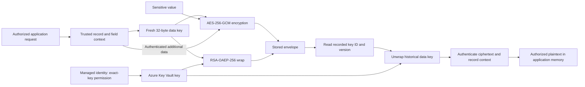

# Encryption-wrapper architecture

## Two keys with different jobs

The DEK is a random 32-byte symmetric key generated for one encryption. AES-GCM uses it locally to encrypt the payload and generate the authentication tag. The RSA key is the wrapping/key-encryption key (KEK), held by Key Vault in the hosted design. RSA-OAEP-256 protects the DEK; RSA is not used to encrypt the full payroll/form payload.

The application stores ciphertext, nonce, tag, wrapped DEK, key ID and exact version. It reuses the recorded version for historical reads. Each domain has an explicit AAD namespace plus record identifiers. A legitimate ciphertext copied to another record/field fails authentication.

## Trust boundaries

- API authorization happens before encryption/decryption; possession of an employee ID is not authorization.
- The database stores the envelope, not an unwrapped data key.
- The runtime identity can wrap/unwrap at one key; key administration is separate.
- The authorized application necessarily handles plaintext in memory. Envelope encryption does not defeat a compromised authorized runtime.
- Key backups, old versions, AAD/schema versions and database rows are a recovery dependency chain.

## Public implementation boundary

The Node field/bank encryption and Key Vault adapter are extracted from actual implementation source. Portable imports and public domain labels are documented in [the source map](SOURCE-MAP.md). Source AES tests inject wrapper fixtures. The Python demo additionally uses real in-memory RSA keys, but does not emulate managed identity, Key Vault custody, HSM behavior or Azure policy.
