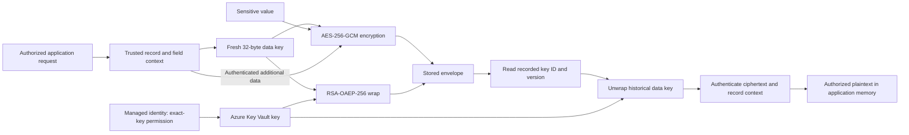

# Encryption-wrapper architecture

**Terms used here:** A fixture is test data or a test setup used instead of real business records. A nonce is a value used once for a particular encryption key.

## Two keys with different jobs

Each encryption starts with a fresh random 32-byte data key, called a DEK. AES-GCM uses that key to protect the value and create a tag that detects changes. A separate RSA key, held by Key Vault in the hosted design, protects the small data key using RSA-OAEP-256. It does not encrypt the whole payroll or form record.

The application saves the encrypted value, the protected data key and the information needed to check and read them later. This includes the nonce, tag and exact Key Vault key version. It also checks the record and field identifiers, so copying an encrypted value to the wrong record or field causes the read to fail.

## Trust boundaries

- API authorization happens before encryption/decryption; possession of an employee ID is not authorization.
- The database stores the envelope, not an unwrapped data key.
- The runtime identity can wrap/unwrap at one key; key administration is separate.
- The authorized application necessarily handles plaintext in memory. Envelope encryption does not defeat a compromised authorized runtime.
- Key backups, old versions, AAD/schema versions and database rows are a recovery dependency chain.

## Public implementation boundary

The Node field/bank encryption and Key Vault adapter are extracted from actual implementation source. Portable imports and public domain labels are documented in [the source map](SOURCE-MAP.md). Source AES tests inject wrapper fixtures. The Python demo additionally uses real in-memory RSA keys, but does not emulate managed identity, Key Vault control, HSM behavior or Azure policy.
